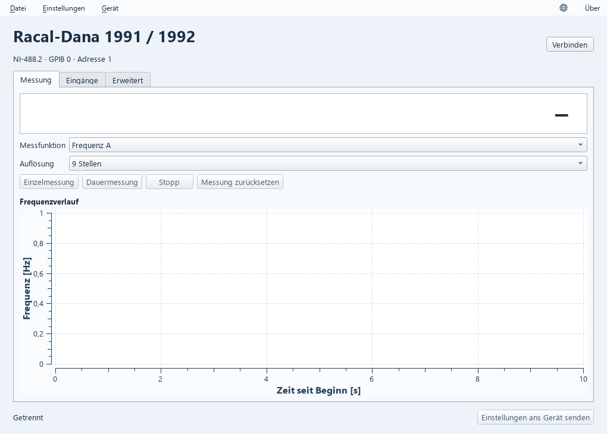

# Racal-Dana 1991 Control

Windows-Anwendung zur GPIB-Steuerung der Frequenzzähler Racal-Dana 1991 und 1992. Sie zeigt einzelne oder fortlaufende Messungen sowie den Frequenzverlauf an. Je nach Gerät und Eingangsoption stehen unter anderem Frequenz, Periode, Zeitintervall, Verhältnis und Ereigniszählung zur Verfügung.

Entwickelt und gepflegt von Ralf Tralow mit Unterstützung von OpenAI Codex.

## Bildschirmaufnahmen

| Hell | Dunkel |
| --- | --- |
| <a href="docs/screenshots/racaldana1991-hell.png"></a> | <a href="docs/screenshots/racaldana1991-dunkel.png"></a> |

## Installation unter Windows

Die Windows-Setups für x86 und x64 im [aktuellen GitHub-Release](https://github.com/GitterRalf/racaldana1991/releases/latest) enthalten die benötigten Qt-, Qwt- und MinGW-DLLs. Der Standardordner für x64 ist `C:\Programme\Racal-Dana 1991 Control`. Für den Download ist ein GitHub-Konto mit Zugriff auf das private Repository erforderlich. Den NI-488.2-Treiber mit Unterstützung für die Programmarchitektur für GPIB separat installieren.

## Bedienung

- Unter **Einstellungen → Verbindung** lassen sich GPIB-Bus und Primäradresse ändern. Voreingestellt sind Bus **0** und Adresse **1**. Gesendete Befehle enden mit CR + LF und EOI auf dem letzten Byte.
- **Verbinden** identifiziert das Gerät. Unter **Messung**, **Eingänge** und **Erweitert** lassen sich die Messart und die Eingangsparameter einstellen. **Einstellungen ans Gerät senden** überträgt die Auswahl.
- **Gerät → Gerätedaten auslesen** fragt unter anderem Gerätekennung, Firmwarestand und Auflösung ab. Der Frequenzverlauf lässt sich über **Datei → Frequenzverlauf leeren** zurücksetzen.
- Das Sprachsymbol bietet Deutsch, English und Français. Unter **Einstellungen → Darstellung** stehen Hell und Dunkel zur Wahl. Die zuletzt verwendete Fensterposition und -größe werden beim nächsten Start wiederhergestellt.
- **Über** zeigt die Programmversion und das animierte OsciViewer-Logo. **Über → Nach Updates suchen** vergleicht die Version manuell mit dem GitHub-Release. Für das private Repository muss die GitHub CLI mit einem berechtigten Konto angemeldet sein (`gh auth login`).

## Bauen

Benötigt werden ein Windows-Kit mit Qt 6 für x64 oder Qt 5.15 für x86 einschließlich Widgets, Concurrent, Network und Linguist Tools, CMake ab 3.24, Ninja und [Qwt 6.3](https://qwt.sourceforge.io/qwtinstall.html) für dasselbe Qt-Kit. Die lokale Qwt-Installation mit Headern, Importbibliothek und DLL wird unter `.deps/qwt` für x64 und `.deps/qwt-qt5-x86` für x86 erwartet. Bei direkter CMake-Konfiguration lässt sich der Pfad mit `-DQWT_ROOT=…` angeben.

~~~powershell
.\build.ps1                    # x64
.\build.ps1 -Architecture x86  # x86
~~~

Das Skript baut `build\RacalDana1991.exe` und stellt die Laufzeit-DLLs bereit. Danach `RacalDana1991.iss` mit Inno Setup kompilieren. Das Skript übernimmt die Version aus `CMakeLists.txt` und das Icon aus `assets/app.rc`. Die Setupdatei landet im Ordner `installer`.


### Windows-Architekturen

Die x86-Ausgabe verwendet Qt 5.15.19 mit MinGW 8.1 und hat einen eigenen
Installationsordner **Racal-Dana 1991 Control (32 Bit)**. Auf 64-Bit-Windows können beide
Ausgaben parallel installiert werden. Die x64-Ausgabe verwendet weiterhin
Qt 6 und ist beim Build der Standard.

Der Build für x86 nutzt `build-x86`, der Build für x64 den Ordner `build`.
Die Installer entstehen im Projektordner mit folgenden Aufrufen.

```powershell
ISCC.exe RacalDana1991.iss
ISCC.exe /DBuildArch=x86 RacalDana1991.iss
```

## Lizenz

Quellcode und animiertes OsciViewer-Logo stehen unter der [MIT-Lizenz](LICENSE). Die Hinweise zu Qt, Qwt und MinGW stehen in [THIRD-PARTY-NOTICES.txt](THIRD-PARTY-NOTICES.txt).
