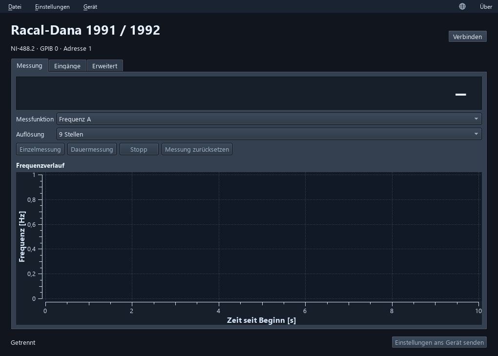

# Racal-Dana 1991 Control

Windows-Anwendung zur GPIB-Steuerung der Frequenzzähler Racal-Dana 1991 und 1992. Sie zeigt einzelne oder fortlaufende Messungen sowie den Frequenzverlauf an. Je nach Gerät und Eingangsoption stehen unter anderem Frequenz, Periode, Zeitintervall, Verhältnis und Ereigniszählung zur Verfügung.

## Bildschirmaufnahmen

| Hell | Dunkel |
| --- | --- |
|  |  |

## Installation unter Windows

Das Windows-x64-Setup im [aktuellen GitHub-Release](https://github.com/GitterRalf/racaldana1991/releases/latest) enthält die benötigten Qt-, Qwt- und MinGW-DLLs. Der Standardordner ist `C:\Programme\Racal-Dana 1991 Control`. Für den Download ist ein GitHub-Konto mit Zugriff auf das private Repository erforderlich. Den 64-Bit-Treiber NI-488.2 für GPIB separat installieren.

## Bedienung

- Unter **Einstellungen → Verbindung** lassen sich GPIB-Bus und Primäradresse ändern. Voreingestellt sind Bus **0** und Adresse **1**. Gesendete Befehle enden mit CR + LF und EOI auf dem letzten Byte.
- **Verbinden** identifiziert das Gerät. Unter **Messung**, **Eingänge** und **Erweitert** lassen sich die Messart und die Eingangsparameter einstellen. **Einstellungen ans Gerät senden** überträgt die Auswahl.
- **Gerät → Gerätedaten auslesen** fragt unter anderem Gerätekennung, Firmwarestand und Auflösung ab. Der Frequenzverlauf lässt sich über **Datei → Frequenzverlauf leeren** zurücksetzen.
- Das Sprachsymbol bietet Deutsch, English und Français. Unter **Einstellungen → Darstellung** stehen Hell und Dunkel zur Wahl. Die zuletzt verwendete Fensterposition und -größe werden beim nächsten Start wiederhergestellt.
- **Über** zeigt die Programmversion und das animierte OsciViewer-Logo. **Über → Nach Updates suchen** vergleicht die Version manuell mit dem GitHub-Release. Für das private Repository muss die GitHub CLI mit einem berechtigten Konto angemeldet sein (`gh auth login`).

## Bauen

Benötigt werden ein 64-Bit-Windows-Kit mit Qt 6 einschließlich Widgets, Concurrent, Network und Linguist Tools, CMake ab 3.24, Ninja und [Qwt 6.3](https://qwt.sourceforge.io/qwtinstall.html) für dasselbe Qt-Kit. Die lokale Qwt-Installation mit Headern, Importbibliothek und DLL wird unter `.deps/qwt` erwartet. Bei direkter CMake-Konfiguration lässt sich der Pfad mit `-DQWT_ROOT=…` angeben.

~~~powershell
.\build.ps1
~~~

Das Skript baut `build\RacalDana1991.exe` und stellt die Laufzeit-DLLs bereit. Danach `RacalDana1991.iss` mit Inno Setup kompilieren. Das Skript übernimmt die Version aus `CMakeLists.txt` und das Icon aus `assets/app.rc`. Die Setupdatei landet im Ordner `installer`.

## Lizenz

Quellcode und animiertes OsciViewer-Logo stehen unter der [MIT-Lizenz](LICENSE). Die Hinweise zu Qt, Qwt und MinGW stehen in [THIRD-PARTY-NOTICES.txt](THIRD-PARTY-NOTICES.txt).
